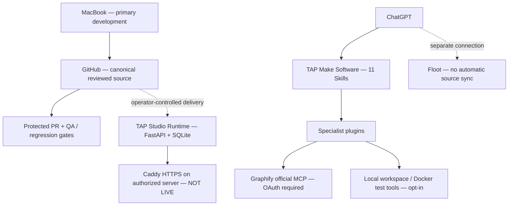

<div align="center">

# TAP Software Factory

**From a natural-language idea to auditable software — with clear limits, reproducible tests, and human-controlled deployment.**

[](https://github.com/thalesandradepereira/tap-engineering-standard/actions/workflows/validate-skill.yml)
[](plugins/tap-make-software/)
[](plugins/tap-studio-runtime/)
[](plugin-inventory.json)
[](DEPLOY_FULLSTACK.md)

**English** · **[Português (Brasil)](README.pt-BR.md)** · **[Repository home](../README.md)** · **[QA report](QA_STATUS.md)** · **[Release notes](RELEASE_NOTES_v4.1.0.md)**

</div>

---

> **Engineering contract:** code in GitHub is not a running service; a connected ChatGPT plugin is not automatically a deployed server; a green CI run is not a production smoke test.

## Overview

TAP Software Factory is a **modular, Git-versioned software engineering ecosystem** centered on `tap-make-software`. It joins specialized Agent Skills, optional local MCP servers, a self-hostable Studio prototype, and a protected GitHub CI workflow. It provides a starting point for web applications and engineering workflows, **not a turnkey clone of Emergent**.

The recommended primary development device is the **MacBook**. The phone is an occasional access device, never a required build runner. GitHub stores the reviewed source. Floot is a **separately connected hosting provider**; a connection does not import or deploy this Python/FastAPI application automatically.

## Architecture



### Implementation inventory

The [machine-readable inventory](plugin-inventory.json) is the version source of truth.

| Component | Version | Scope |
| --- | --- | --- |
| [TAP Make Software](plugins/tap-make-software/) | **4.1.0** | Main orchestrator; **11 integrated Skills** |
| [TAP Studio Runtime](plugins/tap-studio-runtime/) | **0.2.0** | FastAPI, SQLite, project editor, authentication, ZIP export, isolated preview |
| [TAP Code Workspace](plugins/tap-code-workspace/) | 1.0.0 | Restricted local file operations and static checks |
| [TAP Data & Auth](plugins/tap-data-auth/) | 1.0.0 | Data modeling, identity and authorization patterns |
| [TAP Mobile Factory](plugins/tap-mobile-factory/) | 1.0.0 | React Native / Expo planning and build guidance |
| [TAP Deploy & Ops](plugins/tap-deploy-ops/) | 1.0.0 | Deployment, rollback, monitoring and backup gates |
| [TAP QA & Security](plugins/tap-qa-security/) | 1.0.0 | Regression, security, performance and accessibility |
| [TAP Graphify](plugins/tap-graphify/) | 1.0.0 | Adapter for upstream Graphify and its hosted MCP |
| [TAP Sandbox Executor](plugins/tap-sandbox-executor/) | 1.0.0 | Opt-in local Docker test profile, not general cloud compute |
| [TAP Cloud Infrastructure](plugins/tap-cloud-infrastructure/) | 1.0.0 | Infrastructure blueprints, NOT provisioned resources |

**Graphify:** the original upstream project is [Graphify-Labs/graphify](https://github.com/Graphify-Labs/graphify). The TAP integration declares the official `https://api.graphify.com/mcp` endpoint in [its MCP config](plugins/tap-graphify/mcp.json). OAuth and repository indexing require separate authorization. No upstream Graphify binary, hook or indexing credential is included.

## Current functionality and boundaries

| Capability | Available now | What still requires configuration |
| --- | --- | --- |
| Project creation, editor, ZIP export | Implemented in Studio | Host must be started |
| Authentication and persisted projects | Local password/session flow and SQLite | Multiuser lifecycle, OAuth, managed database for scale |
| HTML/CSS/JavaScript preview | Sandboxed iframe | End-to-end browser and production review |
| AI-assisted generation | Optional endpoint contract | Explicit provider, secret, allowlist, user consent and quotas |
| Graphify code graphs | Skill + MCP declaration | OAuth, chosen repositories and indexing |
| Automated QA | GitHub Actions + local suites | Production smoke tests and security review |
| HTTPS and backups | Docker Compose/Caddy + backup script | Authorized Linux host, domain, TLS verification, offsite backups |
| Floot hosting | Connector available | App creation and framework compatibility; no automatic GitHub sync |
| Cloud sandboxes / signed mobile builds | Architecture guidance | Actual worker infrastructure and signing accounts |

## Get started — MacBook

Use the repository as your source of truth. This local setup does **not** create a public site.

```bash
git clone https://github.com/thalesandradepereira/tap-engineering-standard.git
cd tap-engineering-standard/software-factory/plugins/tap-studio-runtime
python3 -m venv .venv
source .venv/bin/activate
python -m pip install -r requirements.txt
export TAP_STUDIO_DB_PATH="$PWD/studio.db"
export TAP_STUDIO_ADMIN_USER="admin"
# Load TAP_STUDIO_ADMIN_PASSWORD privately from your password manager.
python server/studio.py
```

Open `http://127.0.0.1:8080/` **only on your trusted machine**. Use a strong password; never paste it into GitHub, a prompt or a README. The exact [Studio installation guide](plugins/tap-studio-runtime/README.md) documents env settings and the optional model endpoint.

### Self-hosted full stack

The [production runbook](plugins/tap-studio-runtime/deploy/README.production.md) and [infrastructure status](DEPLOY_FULLSTACK.md) cover Linux, Caddy HTTPS, Docker secrets, persistent volumes, consistent SQLite/WAL backups, restore testing and rollback. **They are configuration, not evidence of an operational public domain.** This project is not a horizontally scalable production SaaS yet.

## Quality assurance

The last verified protected GitHub workflow completed **174 tests**: 119 TAP Engineering Standard tests, 23 workspace tests, 8 sandbox profile tests, 5 PWA scaffold tests and 19 Studio tests. These are **unit/regression results**, not a security certification or cloud deployment verification.

Run the portable validators from the **repository root**:

```bash
python3 scripts/validate_skill.py
python3 software-factory/scripts/validate_packages.py
python3 software-factory/scripts/validate_readmes.py
python3 -m unittest discover -s software-factory/plugins/tap-code-workspace/tests -v
python3 -m unittest discover -s software-factory/plugins/tap-sandbox-executor/tests -v
python3 -m unittest discover -s software-factory/plugins/tap-make-software/tests -v
```

For the Studio suite, install its [requirements](plugins/tap-studio-runtime/requirements.txt) in an isolated virtual environment and run `python -m unittest discover -s software-factory/plugins/tap-studio-runtime/tests -v`. For detailed evidence and exclusions, see [QA STATUS](QA_STATUS.md).

## Security, privacy and governance

- **No automatic activation:** Skills cannot independently install Docker, connect GitHub, run external hooks, index private Graphify repositories or spend cloud credits.
- **No secrets in Git:** production configuration and API tokens belong in environment/secret management, outside the repository.
- **No public MCP exposure:** the current Studio HTTP bearer subset is **not** OAuth 2.1-compliant for ChatGPT remote MCP. Add an audited authorization gateway before public use.
- **No implied LGPD compliance:** identity lifecycle, access controls, data retention, incident response and backup restoration must be reviewed before real customer data.
- **Preserve protected branches:** use a reviewed PR, passing CI and verified release notes before tagging.
- **Release evidence:** [CHANGELOG](CHANGELOG.md) documents the software state; [release notes](RELEASE_NOTES_v4.1.0.md) identify shipped code and deployment limitations.

## Release and support

The software-factory version tracks the **main TAP Make Software orchestrator**; component versions evolve separately. See [GitHub Releases](https://github.com/thalesandradepereira/tap-engineering-standard/releases) for published release artifacts. A GitHub Release does not imply cloud deployment.

**Maintainer:** Thales Andrade Pereira · **Engineering standard:** [TAP Engineering Standard](../README.md) · **Built and documented:** Made by TAP.

## Floot Edition — published web Studio v0.1.0

The [Floot-native TAP Studio](floot-edition/README.md) is live at [tap-software-factory.floot.app](https://tap-software-factory.floot.app), with managed PostgreSQL and authentication. Its source [snapshot](floot-edition/snapshot-manifest.json) is **not** a complete Floot export or automatic GitHub->Floot synchronization. Core Python/Graphify remain independent.

### TAP Floot AI Builder v0.2.0

The [hosted Floot Studio](floot-edition/README.md) now provides model-assisted, credits-confirmed single-page generation, with a 3/day account entitlement and no automatic save. Public sign-up is disabled; billed LLM E2E remains to be tested. The original Python/Graphify core is separate.
