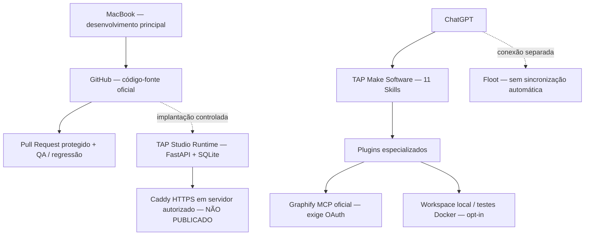

<div align="center">

# TAP Software Factory

**Da ideia em linguagem natural ao software auditável — com testes reproduzíveis, limites explícitos e publicação sob controle humano.**

[](https://github.com/thalesandradepereira/tap-engineering-standard/actions/workflows/validate-skill.yml)
[](plugins/tap-make-software/)
[](plugins/tap-studio-runtime/)
[](plugin-inventory.json)
[](DEPLOY_FULLSTACK.md)

**[English](README.md)** · **Português (Brasil)** · **[Página principal](../README.pt-BR.md)** · **[Relatório de QA](QA_STATUS.md)** · **[Notas da versão](RELEASE_NOTES_v4.1.0.md)**

</div>

---

> **Contrato de engenharia:** código no GitHub não significa serviço em execução; plugin conectado ao ChatGPT não significa servidor publicado; CI verde não substitui teste de produção.

## Visão geral

A TAP Software Factory é um **ecossistema modular de engenharia de software versionado no Git**, organizado em torno do `tap-make-software`. Reúne Agent Skills especializadas, servidores MCP locais opcionais, um protótipo Studio que pode ser hospedado e controles obrigatórios de CI no GitHub. É uma base para criar aplicações web e fluxos de engenharia, **não uma cópia completa e pronta da Emergent**.

O dispositivo principal para desenvolvimento é o **MacBook**. O celular será usado apenas ocasionalmente e não precisa executar builds. O GitHub armazena o código revisado. O Floot é um **provedor de hospedagem conectado separadamente**: a conexão não importa nem publica automaticamente o aplicativo Python/FastAPI.

## Arquitetura



### Inventário de módulos

O [inventário em JSON](plugin-inventory.json) é a fonte de verdade para as versões.

| Componente | Versão | Responsabilidade |
| --- | --- | --- |
| [TAP Make Software](plugins/tap-make-software/) | **4.1.0** | Orquestrador principal; **11 Skills integradas** |
| [TAP Studio Runtime](plugins/tap-studio-runtime/) | **0.2.0** | FastAPI, SQLite, editor, login, ZIP e pré-visualização isolada |
| [TAP Code Workspace](plugins/tap-code-workspace/) | 1.0.0 | Arquivos e inspeções estáticas locais restritas |
| [TAP Data & Auth](plugins/tap-data-auth/) | 1.0.0 | Modelo de dados, autenticação e autorização |
| [TAP Mobile Factory](plugins/tap-mobile-factory/) | 1.0.0 | Arquitetura React Native / Expo e builds |
| [TAP Deploy & Ops](plugins/tap-deploy-ops/) | 1.0.0 | Publicação, recuperação, monitoramento e backups |
| [TAP QA & Security](plugins/tap-qa-security/) | 1.0.0 | Regressão, segurança, desempenho e acessibilidade |
| [TAP Graphify](plugins/tap-graphify/) | 1.0.0 | Integração independente com Graphify e MCP hospedado |
| [TAP Sandbox Executor](plugins/tap-sandbox-executor/) | 1.0.0 | Perfil de testes Docker local e opcional, não cloud genérico |
| [TAP Cloud Infrastructure](plugins/tap-cloud-infrastructure/) | 1.0.0 | Arquitetura cloud, sem provisionamento automático |

**Graphify:** o projeto original está em [Graphify-Labs/graphify](https://github.com/Graphify-Labs/graphify). A integração TAP declara `https://api.graphify.com/mcp` na [configuração MCP](plugins/tap-graphify/mcp.json). OAuth e indexação de repositórios exigem autorização. Nenhum binário, hook ou token Graphify foi distribuído com o TAP.

## Funcionalidades e limites reais

| Capacidade | O que existe | Dependência pendente |
| --- | --- | --- |
| Criar projetos, editar arquivos e exportar ZIP | Implementado no Studio | Iniciar o host |
| Login e projetos persistentes | Senha/sessão local e SQLite | Ciclo multiusuário, OAuth e banco gerenciado para escala |
| Preview HTML/CSS/JavaScript | iframe isolado | QA visual completo e revisão em produção |
| Geração com IA | Contrato opcional de endpoint | Provedor, segredo, allowlist, consentimento e cotas |
| Grafos de código Graphify | Skill + declaração MCP | OAuth e indexação autorizada |
| Testes e qualidade | GitHub Actions e suítes locais | Testes reais de produção e auditoria |
| HTTPS e backups | Docker Compose/Caddy e script de cópia | Servidor Linux, domínio, TLS e cópia externa |
| Hospedagem Floot | Plugin conectado | Criar projeto compatível; sem sincronização GitHub automática |
| Sandbox cloud e builds mobile assinados | Diretrizes de arquitetura | Infraestrutura e contas de assinatura |

## Primeiros passos — MacBook

Use o repositório como **fonte oficial do código**. Esta execução é local, não publica o site na Internet.

```bash
git clone https://github.com/thalesandradepereira/tap-engineering-standard.git
cd tap-engineering-standard/software-factory/plugins/tap-studio-runtime
python3 -m venv .venv
source .venv/bin/activate
python -m pip install -r requirements.txt
export TAP_STUDIO_DB_PATH="$PWD/studio.db"
export TAP_STUDIO_ADMIN_USER="admin"
# Carregue TAP_STUDIO_ADMIN_PASSWORD de forma privada, via gerenciador de senhas.
python server/studio.py
```

Acesse `http://127.0.0.1:8080/` **somente em uma máquina confiável**. Use uma senha forte; não a publique no GitHub, nos prompts ou no README. O [manual do Studio](plugins/tap-studio-runtime/README.md) explica as variáveis e o modelo de IA opcional.

### Hospedagem full-stack própria

O [manual de produção](plugins/tap-studio-runtime/deploy/README.production.md) e o [status de infraestrutura](DEPLOY_FULLSTACK.md) explicam Linux, Caddy HTTPS, Docker Secrets, volumes persistentes, backups SQLite/WAL consistentes, restauração e rollback. **São configurações, não comprovação de um domínio público funcionando.** O projeto ainda não é um SaaS de produção com escalabilidade horizontal.

## Garantia de qualidade

O último workflow protegido do GitHub que foi verificado concluiu **174 testes**: 119 do TAP Engineering Standard, 23 do workspace, 8 do perfil sandbox, 5 do gerador PWA e 19 do Studio. São **testes unitários e de regressão**, não certificação de segurança ou prova de implantação cloud.

Execute os validadores portáteis a partir da **raiz do repositório**:

```bash
python3 scripts/validate_skill.py
python3 software-factory/scripts/validate_packages.py
python3 software-factory/scripts/validate_readmes.py
python3 -m unittest discover -s software-factory/plugins/tap-code-workspace/tests -v
python3 -m unittest discover -s software-factory/plugins/tap-sandbox-executor/tests -v
python3 -m unittest discover -s software-factory/plugins/tap-make-software/tests -v
```

Para os testes do Studio, instale as [dependências](plugins/tap-studio-runtime/requirements.txt) em ambiente virtual separado e execute `python -m unittest discover -s software-factory/plugins/tap-studio-runtime/tests -v`. Evidências e limitações: [STATUS DE QA](QA_STATUS.md).

## Segurança, privacidade e governança

- **Nada de ativação automática:** Skills não instalam Docker, não conectam contas, não acionam hooks externos e não indexam repositórios privados sem autorização.
- **Segredos fora do Git:** credenciais e configurações reais de produção pertencem a um gerenciador de segredos, não ao código-fonte.
- **MCP remoto não liberado:** o endpoint HTTP do Studio com bearer token **não** implementa OAuth 2.1 para o ChatGPT. Exige gateway auditado.
- **LGPD não presumida:** contas, exclusão de dados, retenção, incidentes, autorização e testes de restauração precisam de análise antes de processar dados reais de clientes.
- **Branch principal protegida:** alterações por PR revisado, CI aprovado e notas de versão verificadas antes de criar tags.
- **Evidências de release:** o [CHANGELOG](CHANGELOG.md) representa as mudanças; as [notas da versão](RELEASE_NOTES_v4.1.0.md) registram entregas e limitações.

## Versões e suporte

A versão da Software Factory segue o **orquestrador TAP Make Software**. Cada plugin especializado possui versão independente. Consulte [GitHub Releases](https://github.com/thalesandradepereira/tap-engineering-standard/releases) para entregas publicadas. Um GitHub Release não equivale a hospedagem ativa.

**Responsável:** Thales Andrade Pereira · **Padrão de engenharia:** [TAP Engineering Standard](../README.pt-BR.md) · **Desenvolvido e documentado:** Made by TAP.

## Edição Floot — Studio web publicado v0.1.0

O [TAP Studio nativo do Floot](floot-edition/README.pt-BR.md) está publicado em [tap-software-factory.floot.app](https://tap-software-factory.floot.app), com PostgreSQL e autenticação. O [snapshot](floot-edition/snapshot-manifest.json) **não é** export completo nem sincronização automática GitHub->Floot. O Python/Graphify original permanece separado.

### TAP Floot AI Builder v0.2.0

O [Studio hospedado no Floot](floot-edition/README.pt-BR.md) agora permite gerar páginas por IA, com aceite de créditos por chamada, limite de 3 tentativas por dia e revisão antes de salvar. Cadastro público bloqueado; teste com modelo pago ainda pendente. O núcleo Python e Graphify permanecem independentes.
